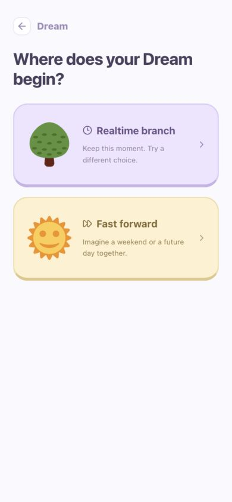
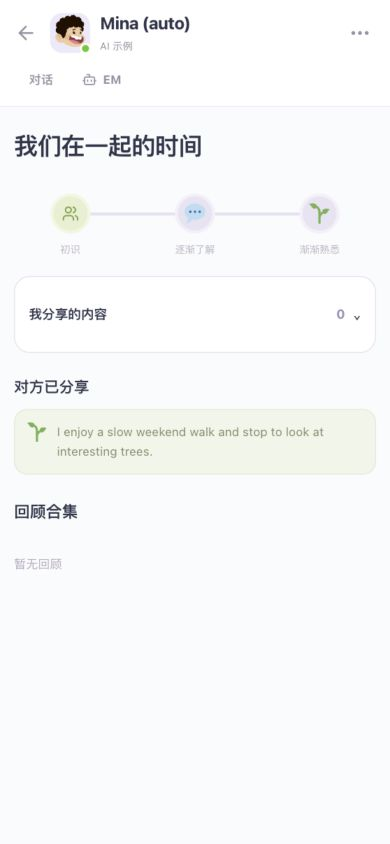

# Aivow

面向已有社交连接的情感化智能体原型。EM 是 ME 的反写，代表由本人设定、可以随时纠正的数字分身。

项目关注的是：**在尚不了解彼此时，仍能对这次相遇保有掌控感。** 用户通过日常情景试演、共创与真实回应逐步了解对方。互动来自朋友、已接受的引荐或共同生活圈，不做陌生人匹配、伴侣排名或契合度预测。

[在线体验](https://aivow-demo.aivow.workers.dev) · [本地运行](#本地运行) · [设计依据](RESEARCH.md) · [云端配置](deploy/README.md)

## 界面与核心流程

以下为当前原型的实际手机尺寸截图。界面默认英文，可在 **Me → Settings** 切换中文。

<table>
  <tr>
    <th>Life → Dream</th>
    <th>Chats → More → 我们在一起的时间</th>
  </tr>
  <tr>
    <td align="center"></td>
    <td align="center"></td>
  </tr>
  <tr>
    <td>从当下换一种选择，或想象未来的一天；之后再逐步选择对象、片段、地点和节奏。</td>
    <td>集中查看已分享的内容、带出处的理解记录与回顾，不用反复翻聊天记录。</td>
  </tr>
</table>

一次完整体验是：**已有连接 → 选择生活片段 → EM 推演 → 调整或另开分支 → 本人回应 → 对话回顾。**

| 模块 | 可以做什么 |
| --- | --- |
| **Life** | 在真实底图上观察虚拟 EM 的活动；从独立 Dream 页面逐步选择时间方式、对象与场景。 |
| **Chats → Chat** | 和本人聊天；发送 Dream 邀请；把选中的场景片段作为卡片引用到聊天中。 |
| **Chats → EM** | 查看地图与场景，通过指令控制自己的 EM，暂停、加速、纠偏、分岔或生成回顾。 |
| **More → Time together** | 收集对话回顾、按关系授权的披露内容和可纠正的理解记录。 |
| **Me → EM** | 修改形象、兴趣、表达风格、行为权限与分类记忆；确认后才接受长期偏好建议。 |

### Dream 的两组选择

| 维度 | 方式 |
| --- | --- |
| 时间 | **Realtime branch**：保留此刻，尝试另一种选择。**Fast forward**：想象未来的生活片段。 |
| 参与 | **Private**：仅自己可见，对方回应标为想象投影。**Shared**：预览选中片段，邀请对方明确加入。 |

时间和参与方式彼此独立。私人想象不会变成对方本人的表达；共同分支中任一方都能暂停或撤回。Dream 可以一直用于共创和交流，现实约见需要本人决定。

推演结束后，对话中会留下 **EM 行动总结、最多三张带来源的 emoji 卡片，以及后续话题建议**。回顾可以回看、引用或另开分支。一次纠偏只影响所在分支，不会自动改写长期记忆。

## 先试一遍

1. **注册并设置 EM。** 首次使用采用形象、兴趣气泡、表达滑块和行为选项；也可使用默认 EM。随后有可跳过的新手引导。五分钟是设计目标，尚未完成用户计时验证。
2. **配置 AI。** 在 **Me → Settings → AI** 填写、测试并保存自己的 DeepSeek API key。未配置或调用失败时，会在使用处显示错误。
3. **从 Life 开始 Dream。** 依次选择实时／加速、已有连接、生活片段、地点与节奏。点击开始前不会创建分支或调用模型。
4. **控制 EM，再与本人交流。** 在场景中调整安排、找话题、暂停或结束。引用到真人聊天的内容需要自己点击发送。

内置两种明确标注的测试角色：

| 角色 | 用途 |
| --- | --- |
| **Mina (auto)** | 具有固定虚构人格，由当前用户配置的 AI 实时回复；消息标为 AI 示例。 |
| **Mina (dead)** | 模拟长期离线的人：可以留言和私人想象，不会回复或主动加入共同 Dream。 |

**和朋友测试：** 双方打开同一个线上地址并分别注册。一方从 **Me → My circle** 分享邀请，另一方加入；在 **Chats → New chat** 发出并接受好友请求后交流。线上账号与本地账号使用不同数据库。

## 本地运行

需要 **Node.js 22.13+、npm 和 Python 3**。首次克隆后运行：

```sh
git clone https://github.com/Shoreee/Aivow.git
cd Aivow
npm ci
npm run setup:local
npm run dev
```

打开 [http://localhost:5173](http://localhost:5173)。手机与电脑在同一网络时，使用开发服务器打印的 Network 地址。

`setup:local` 只初始化本地环境：在已忽略的 `.dev.vars` 中生成加密密钥，并为全新本地 D1 应用迁移。已有完整数据库和加密密钥会保留；检测到不完整的旧数据库时会停止，避免覆盖数据。它不创建云资源、不部署，也不添加 DeepSeek key。

需要稳定演示时：

```sh
npm run build
npm start
```

账号、聊天和 Dream 数据保存在 `.wrangler/state/`。本地服务运行时，后台可以完成有限一轮 Dream；电脑或服务停止后不运行。底图瓦片和模型调用需要联网。

## 数据、权限与实现边界

- **按关系披露。** 未获授权的对方记忆不会进入模型输入。私人分支使用开始时获准的信息快照，新增授权不会自动扩展旧分支；撤回会限制后续取用。
- **保留来源。** 真人表达、EM 提案、想象投影和 AI 示例分别标记。EM 自聊、播放时长或卡片浏览不会推进关系阶段；阶段变化需要双方确认。
- **本人掌控。** 暂停、撤回、屏蔽、本人介入或权限变化会使尚未完成的生成失效。纠偏形成的长期偏好必须经本人接受。
- **每人自配 AI。** DeepSeek key 仅在服务端按账户加密保存；前端只获得配置状态和掩码。仓库没有内置 key，也没有共享环境 key 兜底。
- **有限后台。** 默认每轮最多八次生成，双方连续九十秒无操作停止，最长三分钟；继续需要主动操作。这些是可调整的演示参数。
- **地图与账号边界。** 地图中的 EM 路径是虚拟活动，不采集手机 GPS。注册使用真实持久化账号与会话，暂未实现邮箱验证和密码找回。

## 代码与验证

| 位置 | 职责 |
| --- | --- |
| `app/` | React 页面、选择式设定、Life、聊天、场景与中英文界面。 |
| `app/api/` | 注册登录、世界状态、Dream 操作、AI 设置和示例角色回复接口。 |
| `lib/dream.ts`、`lib/dream-runner.ts` | 分支、权限投影、推演、取消校验与回顾。 |
| `lib/ai.ts`、`lib/store.ts` | DeepSeek 调用、账户密钥加密、D1 持久化与版本控制。 |
| `worker/dream-scheduler.ts` | Dream 与示例聊天的 Durable Object 定时任务。 |
| `drizzle/`、`db/` | 数据表与保留旧账号的迁移。 |
| `scripts/` | 本地初始化、权限／并发测试、线上接口验证与离线发布配置检查。 |

技术栈：**React · TypeScript · Vinext / Vite · Cloudflare Workers / D1 / Durable Objects · MapLibre / OpenFreeMap · DeepSeek API**。

```sh
npx tsc --noEmit
npm run build
npm run cloudflare:check

# 另一个终端先运行 npm run dev
python3 scripts/check-dream-api.py
python3 scripts/check-conversation-api.py
```

检查覆盖账号隔离、披露与撤权、邀请预览、私人分支、双方确认、过期生成、离线角色和缺少 AI 配置等场景。线上还验证了 HTTPS 会话、双账号聊天及两类后台定时任务；验证范围与网络限制见 [发布记录](deploy/DEPLOYMENT.md)。

GitHub Actions 只执行检查和构建，**不会部署或操作线上数据库**。`cloudflare:check` 使用临时配置进行离线打包与空库检查；真实云端配置留在被忽略的 `deploy/cloudflare.local.json`。后续云端更新见 [配置说明](deploy/README.md)。

## 设计依据与素材

[研究记录](RESEARCH.md) 区分公开竞品证据、理论依据和本项目假设；[实现计划](PLAN.md) 记录当前范围。Dream 不用于预测真实心意或证明伴侣适配性。

地图使用 OpenStreetMap / OpenMapTiles / OpenFreeMap，头像使用 DiceBear Big Smile，情景插图与回顾 emoji 使用 Twemoji。来源与许可保留于 [素材清单](public/assets/credits.txt) 及各素材目录。
